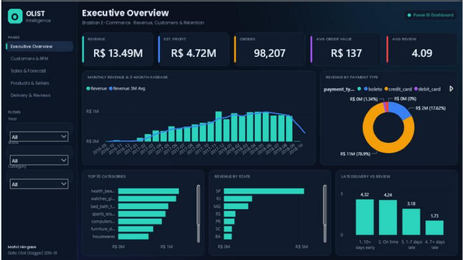
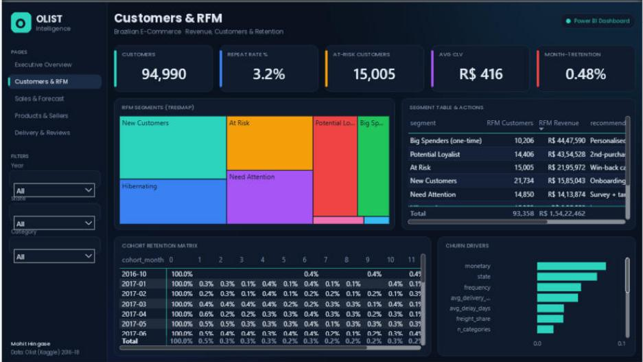
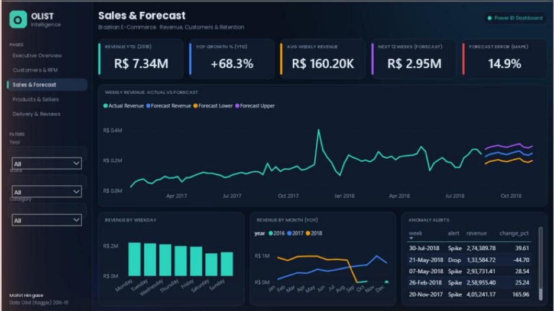
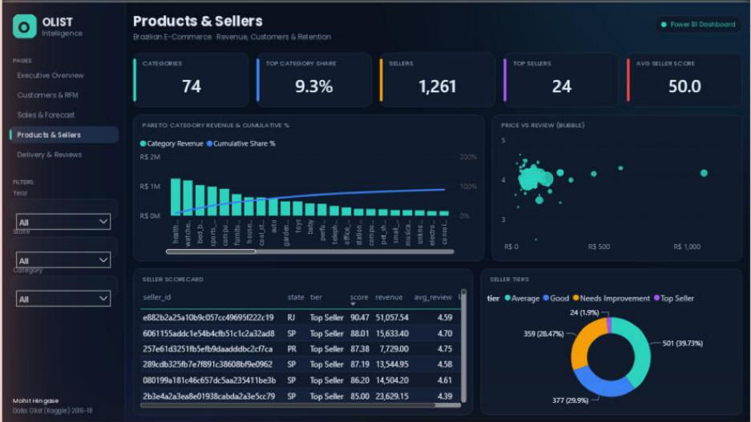
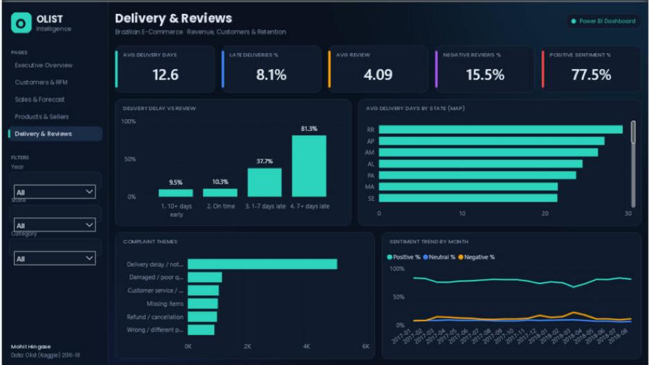

# 🏆 Olist AI-Powered E-Commerce Intelligence & Customer Retention Platform

End-to-end analytics platform on the **real Brazilian E-Commerce Public Dataset by Olist** (~100k orders, 2016–2018):
**Python ETL → PostgreSQL/SQLite star schema → Advanced SQL → ML → Power BI + DAX → Gemini AI chatbot → Streamlit app.**

📊 **Power BI:** [`powerbi/Olist_Dashboard/Olist_Dashboard.pbix`](powerbi/Olist_Dashboard) (5 pages) · 🌐 **Web app:** Streamlit (13 tabs) · 🔗 **Live demo:** _coming soon_



## 💡 Key business insights (real data)
| # | Insight | Number | Recommended action |
|---|---|---|---|
| 1 | **Late delivery kills ratings** | 7+ days late → avg review **1.73★** and **81% negative** (on-time: 4.24★) | Fix logistics before spending on marketing |
| 2 | **Almost nobody comes back** | Repeat-purchase rate only **~3%**; cohort retention < 1% after month 1 | Post-purchase win-back emails, loyalty coupon |
| 3 | **São Paulo is the business** | SP = **38% of revenue** with fastest delivery (8.8 days); RJ 13% but 15.3 days & lower reviews | Add RJ / North-East warehouse capacity |
| 4 | **Strong growth** | 2018 YTD revenue **R$ 7.34M, +68% YoY**; forecast **R$ 2.95M** for next 12 weeks | Plan seller & logistics capacity ahead |
| 5 | **Few categories drive revenue** | Top 3 (health_beauty, watches_gifts, bed_bath_table) ≈ **26%** of revenue | Focus promotions & seller onboarding there |

Overall: **R$ 13.49M revenue · 98,207 orders · 94,990 customers · AOV R$ 137 · 8.1% late deliveries · 77.5% positive reviews.**

## 📸 Screenshots

### Power BI dashboard (5 pages, dark theme, synced slicers, page navigation)
| Executive Overview | Customers & RFM |
|---|---|
|  |  |
| **Sales & Forecast** | **Products & Sellers** |
|  |  |
| **Delivery & Reviews** | |
|  | |

<!--APP_SCREENSHOTS-->

## ✨ Features
| Area | What it answers | Code |
|---|---|---|
| 📤 **Upload & Analyze** | Upload ANY CSV/Excel/JSON → auto cleaning, profiling, KPIs, charts, chart builder, insights, AI Q&A, report | `src/auto_analyzer.py`, `src/universal.py` |
| 📊 Revenue & Profit | Revenue, GMV, est. profit, AOV, MoM/YoY, **anomaly alerts** | `src/analytics.py`, `src/advanced.py` |
| 👥 RFM Segmentation | Champions / At-Risk / Hibernating + actions, KMeans | `src/rfm.py` |
| 🔥 Cohort Retention | % of each monthly cohort that buys again | `src/advanced.py` |
| 💰 Customer Lifetime Value | Historical + predicted 12-month value, CLV tiers | `src/advanced.py` |
| ⚠️ Churn Prediction | Who won't come back? value at risk (time-split, no leakage) | `src/churn.py` |
| 🔮 Sales Forecast | Next 12 weeks, back-tested vs baseline (**MAPE 14.9% vs 19.9%**) | `src/forecast.py` |
| 🛍️ Products & Basket | Pareto/ABC, category pairs bought together (lift) | `src/analytics.py`, `src/advanced.py` |
| 🏪 Seller Scorecard | 0–100 score: reviews, on-time, revenue, speed | `src/advanced.py` |
| 😊 Review Sentiment | Portuguese sentiment + complaint themes (+ Gemini summary) | `src/sentiment.py` |
| 🧪 What-if Simulator | "Cut late deliveries 50% → reviews, repeat buyers, revenue?" | `src/advanced.py` |
| 💬 AI Chatbot | Ask in English/Hinglish; data questions → SQL + table | `src/ai/chatbot.py` |
| 🤖 AI Analyst | Natural language → safe SQL, AI executive report (HTML/PDF) | `src/ai/` |
| 📈 Power BI + DAX | 5-page dashboard, 19 tables, star schema, DAX measures | `powerbi/` |

## 🚀 Run locally (Windows)
1. `pip install -r requirements.txt`
2. Download the dataset from [Kaggle](https://www.kaggle.com/datasets/olistbr/brazilian-ecommerce) → put the 9 CSVs in `data/raw/`
3. Double-click **`run_pipeline.bat`** (ETL + analytics + ML, ~3–5 min)
4. Create `env.txt` with `GEMINI_API_KEY=...` (free key: https://aistudio.google.com/app/apikey) — optional, app works without it
5. Double-click **`run_app.bat`** → dashboard opens in the browser
6. Power BI: open `powerbi/Olist_Dashboard/Olist_Dashboard.pbix` (or the `.pbip` project). If the folder is not `E:\olist-intelligence`, change the **DataFolder** parameter (Transform data → Manage parameters) and click Refresh.

## 🧠 Methodology highlights
- **Customer key** = `customer_unique_id` (Olist issues a new `customer_id` per order).
- **Profit** = revenue × assumed margin (35%, configurable) — Olist has no cost data.
- **Churn**: features before cutoff, label after (180-day window) → no leakage; ROC-AUC 0.65, top-decile lift 3.0×.
- **Forecast**: weekly lag/seasonality GBM blended with a naive baseline, back-tested (MAPE 14.9% vs 19.9% baseline).
- **CLV**: transparent heuristic (return probability × AOV × expected orders) — explainable vs black-box.
- **Sentiment**: lexicon with negation handling + star rating; Gemini turns complaints into actions.
- **AI safety**: SELECT-only SQL, keyword blocklist, auto-LIMIT, read-only role; built-in SQL fallback when the LLM is busy.
- **Power BI as code**: the report is a PBIP project (TMDL semantic model + PBIR report JSON) generated by `powerbi/build_pbip.py`.

## 📂 Structure
```
app/streamlit_app.py      13-tab web app (incl. AI Chatbot & Analyst, Upload & Analyze)
src/                      etl, db, analytics, rfm, churn, forecast, advanced, sentiment, report, universal, ai/
sql/                      PostgreSQL role, constraints, analytics views, advanced queries
powerbi/                  Olist_Dashboard (PBIP + PBIX), theme, backgrounds, DAX measures, generator script
data/processed/           aggregates for Power BI / app (large tables rebuilt by the pipeline)
docs/screenshots/         dashboard & app screenshots
sample_uploads/           sample CSVs to try "Upload & Analyze"
pipeline.py               one command to rebuild everything
```

## 🛠️ Tech stack
Python (pandas, scikit-learn) · SQL (PostgreSQL / SQLite) · Power BI + DAX · Streamlit + Plotly · Google Gemini API

**Author:** Mohit Hingase · [GitHub](https://github.com/MOHIT247ij) · [LinkedIn](https://www.linkedin.com/in/mohit-hingase-318a88249)
