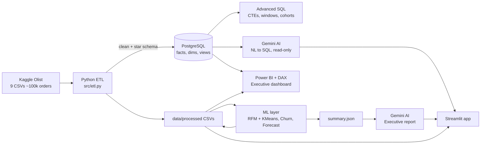

# Architecture

## Layers
| Layer | Tech | Files |
|---|---|---|
| Ingestion | Kaggle API | `scripts/download_data.py` |
| ETL | pandas | `src/etl.py` |
| Storage | PostgreSQL (SQLite fallback) | `src/db.py`, `sql/01_*.sql` |
| SQL analytics | PostgreSQL views + queries | `sql/02_*.sql`, `sql/03_*.sql` |
| Analytics | pandas | `src/analytics.py` |
| Segmentation | RFM + KMeans | `src/rfm.py` |
| Churn | scikit-learn (LogReg, HistGB) | `src/churn.py` |
| Forecast | GradientBoosting w/ lag features | `src/forecast.py` |
| AI | Google Gemini (`google-genai`) | `src/ai/*` |
| BI | Power BI + DAX | `powerbi/DAX_measures.md` |
| App | Streamlit + Plotly | `app/streamlit_app.py` |

## Key design decisions
- **customer_unique_id** is the real customer (Olist creates a new `customer_id` per order).
- **Profit is estimated** (`ASSUMED_GROSS_MARGIN`) — Olist publishes no cost data. Stated everywhere.
- **Churn is time-split** (features before cutoff, label after) → no data leakage.
- **NL→SQL guardrails**: SELECT-only, single statement, keyword blocklist, auto LIMIT, read-only DB role, statement timeout, one self-correction retry.
- **Forecast** is always compared against a naive baseline — the model must beat it to be trusted.
